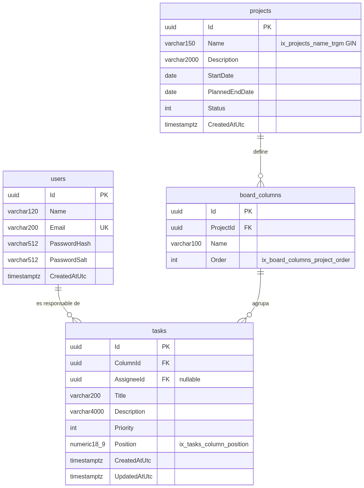

# ScrumBoard — Gestión ágil (Angular 17 + .NET 8)

Aplicativo web de gestión de proyectos ágiles solicitado en la prueba técnica
**IDEASGROUP-REM-LAT-26-2907**: proyectos, columnas configurables, tablero kanban con orden
persistente, sincronización en tiempo real y reporte del proyecto en PDF y Excel.

> **Estado:** solución completa. Backend hexagonal (.NET 8 + PostgreSQL + SignalR + QuestPDF/ClosedXML)
> y SPA Angular 17 con PrimeNG (layout tipo Sakai). Docker Compose levanta base de datos, API y SPA
> con nginx.


---

## Tabla de contenido

- [Requisitos previos](#requisitos-previos)
- [Arranque rápido con Docker](#arranque-rápido-con-docker)
- [Arranque en modo desarrollo](#arranque-en-modo-desarrollo)
- [Variables de entorno](#variables-de-entorno)
- [Usuarios precargados](#usuarios-precargados)
- [Cómo probar la API con Postman](#cómo-probar-la-api-con-postman)
- [Endpoints](#endpoints)
- [Probar la sincronización en tiempo real](#probar-la-sincronización-en-tiempo-real)
- [Modelo de base de datos](#modelo-de-base-de-datos)
- [Migraciones incrementales](#migraciones-incrementales)
- [Pruebas automatizadas](#pruebas-automatizadas)
- [Decisiones arquitectónicas](#decisiones-arquitectónicas)
- [Solución de problemas](#solución-de-problemas)
- [Uso de asistentes de inteligencia artificial](#uso-de-asistentes-de-inteligencia-artificial)
- [Arquitectura del frontend](#arquitectura-del-frontend)
- [Checklist de verificación](#checklist-de-verificación)

---

## Requisitos previos

| Herramienta | Versión | Necesaria para |
|---|---|---|
| Docker Desktop | 24 o superior | Arranque completo (base de datos + API + SPA) |
| .NET SDK | 8.0 o superior | Solo para el modo desarrollo y las pruebas del backend |
| Node.js | 20 o superior | Solo para el modo desarrollo y las pruebas del frontend |
| Git | cualquiera | Clonar el repositorio |

La solución tiene como destino `net8.0`. Un SDK más reciente (9 o 10) también la compila porque el
*targeting pack* de .NET 8 se resuelve por NuGet.

---

## Arranque rápido con Docker

Tres comandos desde la raíz del repositorio:

```powershell
git clone <url-del-repositorio>
cd backendIDEASGROUP
Copy-Item .env.example .env
docker compose up -d --build
```

En Linux o macOS, `cp .env.example .env`.

Eso levanta tres contenedores:

| Servicio | Contenedor | URL |
|---|---|---|
| PostgreSQL 16 | `scrumboard-db` | `localhost:5432` |
| API .NET 8 | `scrumboard-api` | http://localhost:8080 |
| SPA (nginx) | `scrumboard-web` | http://localhost:8081 |

Comprobaciones inmediatas:

```powershell
docker compose ps                                  # db healthy, api y web Up
curl http://localhost:8080/health                  # {"status":"ok"}
start http://localhost:8081                        # aplicativo web
start http://localhost:8080/swagger                # documentación interactiva
```

La API **aplica las migraciones al arrancar**, así que la base queda creada y con los usuarios
semilla sin ningún paso adicional. El servicio `api` declara `depends_on: condition: service_healthy`
contra el `healthcheck` de Postgres: sin eso el contenedor intentaría migrar antes de que la base
acepte conexiones. El SPA se construye en imagen multi-stage (Node → nginx) y el navegador llama a
la API en `http://localhost:8080` (origen permitido en CORS).

Para detener sin perder datos, `docker compose down`. Para volver a un entorno limpio de verdad,
`docker compose down -v` (elimina el volumen `pgdata`).

---

## Arranque en modo desarrollo

Base de datos en Docker, API y SPA en el host:

```powershell
Copy-Item .env.example .env
docker compose up -d db
dotnet restore
dotnet tool restore
dotnet ef database update --project src/ScrumBoard.Infrastructure --startup-project src/ScrumBoard.Api
dotnet run --project src/ScrumBoard.Api --urls http://localhost:5080
```

En otra terminal:

```powershell
cd frontend
npm install
npm start
# http://localhost:4200  (proxy hacia :5080 en proxy.conf.json)
```

No hace falta exportar variables a mano: al arrancar fuera de un contenedor la API lee el archivo
`.env` de la raíz y, al detectar que no corre en Docker, usa `ConnectionStrings__DefaultLocal`
(`Host=localhost`) en lugar de `ConnectionStrings__Default` (`Host=db`). Las variables ya presentes
en el entorno siempre tienen prioridad sobre el archivo. El SPA lee `apiBaseUrl` / `hubUrl` solo
desde `frontend/src/environments/`.

---

## Variables de entorno

Toda la configuración sensible vive en `.env`, que está en `.gitignore`. El repositorio versiona
únicamente `.env.example`, **con los valores por defecto ya completos** para agilizar la evaluación.

| Variable | Descripción |
|---|---|
| `POSTGRES_DB` / `POSTGRES_USER` / `POSTGRES_PASSWORD` | Credenciales del contenedor de Postgres |
| `POSTGRES_PORT` | Puerto publicado en el host (cámbialo a `5433` si ya tienes Postgres local) |
| `API_PORT` | Puerto publicado de la API (por defecto `8080`) |
| `WEB_PORT` | Puerto publicado del SPA nginx (por defecto `8081`) |
| `ConnectionStrings__Default` | Cadena usada dentro de Compose (`Host=db`) |
| `ConnectionStrings__DefaultLocal` | Cadena usada al ejecutar la API en el host (`Host=localhost`) |
| `Jwt__Issuer` / `Jwt__Audience` | Emisor y audiencia validados en cada token |
| `Jwt__Key` | Clave HMAC-SHA256; mínimo 32 caracteres o la API no arranca |
| `Jwt__ExpiresMinutes` | Vigencia del token |
| `Security__PasswordPepper` | Pepper de las contraseñas; **no** se guarda en la base de datos |
| `Cors__AllowedOrigins__0..n` | Orígenes permitidos para el SPA y el hub |

El doble guion bajo es el separador de secciones de configuración en .NET, así que estas variables
sobrescriben la configuración sin una sola línea de código adicional.

---

## Usuarios precargados

Insertados por la migración semilla `SeedDefaultUsers`, con contraseña almacenada como
PBKDF2-HMAC-SHA256 (100 000 iteraciones), salt aleatorio por usuario y pepper de configuración.

| Correo | Contraseña | Nombre |
|---|---|---|
| `admin@ideasgroup.test` | `Admin123*` | Admin IdeasGroup |
| `dev@ideasgroup.test` | `Dev123*` | Dev IdeasGroup |

> Los hashes de la semilla se generaron con el pepper que trae `.env.example`
> (`dev-pepper-ideasgroup-2026`). Si lo cambias, estos dos usuarios dejan de poder iniciar sesión:
> es precisamente el efecto que se busca de un pepper. La prueba
> `SeededCredentials_MatchTheDocumentedPepper` vigila que hashes y pepper no se desincronicen.

---

## Cómo probar la API con Postman

1. Importa `docs/ScrumBoard.postman_collection.json` en Postman
   (*Import → File*).
2. Revisa la variable de colección `baseUrl`: `http://localhost:8080` con Docker,
   `http://localhost:5080` en modo desarrollo.
3. Ejecuta **`1. Autenticacion → Login (admin)`**. El script de test guarda el token en la variable
   `token`; el resto de las carpetas ya heredan la autenticación *Bearer* de la colección, así que no
   tienes que copiar nada a mano.
4. Ejecuta las carpetas en orden (`2. Proyectos` → `3. Columnas` → `4. Tareas y arrastre` →
   `5. Reportes`). Cada alta guarda su identificador (`projectId`, `columnAId`, `taskBId`…) en las
   variables de la colección, de modo que las peticiones siguientes lo reutilizan.

La colección incluye casos negativos ya preparados: login con contraseña incorrecta (401), petición
sin token (401), borrado de una columna con tareas (409) y formato de reporte inexistente (400).

Si prefieres no usar Postman, el equivalente mínimo con `curl`:

```bash
# 1. Token
curl -X POST http://localhost:8080/api/auth/login \
  -H "Content-Type: application/json" \
  -d '{"email":"admin@ideasgroup.test","password":"Admin123*"}'

# 2. Usar el token devuelto
curl http://localhost:8080/api/projects -H "Authorization: Bearer <token>"
```

También puedes usar Swagger en `http://localhost:8080/swagger`: el botón **Authorize** acepta el
token del login (solo el token, sin la palabra `Bearer`).

---

## Endpoints

Todos exigen `Authorization: Bearer <token>` salvo los marcados como públicos: la política de
autorización por defecto rechaza cualquier petición anónima y hay que optar explícitamente por
`[AllowAnonymous]`.

| Método | Ruta | Descripción |
|---|---|---|
| `POST` | `/api/auth/login` | Público. Devuelve token, vencimiento y datos del usuario |
| `GET` | `/api/auth/users` | Usuarios disponibles como responsables |
| `GET` | `/api/projects` | Listado paginado, filtro parcial por nombre (`?name=&page=&pageSize=`) |
| `GET` | `/api/projects/{id}` | Detalle |
| `POST` | `/api/projects` | Alta |
| `PUT` | `/api/projects/{id}` | Edición |
| `DELETE` | `/api/projects/{id}` | Baja |
| `GET` | `/api/projects/{id}/board` | Tablero completo; filtros `assigneeId`, `priority`, `search` |
| `GET` | `/api/projects/{projectId}/columns` | Columnas ordenadas |
| `POST` | `/api/projects/{projectId}/columns` | Alta de columna |
| `PUT` | `/api/columns/{id}` | Renombrar |
| `DELETE` | `/api/columns/{id}` | Baja; **409** si la columna contiene tareas |
| `PUT` | `/api/projects/{projectId}/columns/order` | Reordenamiento completo |
| `GET` | `/api/tasks/{id}` | Detalle de tarea |
| `GET` | `/api/columns/{columnId}/tasks` | Tareas de una columna, ya ordenadas |
| `POST` | `/api/tasks` | Alta |
| `PUT` | `/api/tasks/{id}` | Edición (incluye responsable y prioridad) |
| `DELETE` | `/api/tasks/{id}` | Baja |
| `PATCH` | `/api/tasks/{id}/position` | Arrastrar y soltar: mueve y reordena |
| `GET` | `/api/projects/{projectId}/report?format=pdf\|xlsx` | Descarga del reporte |
| `GET` | `/api/projects/{projectId}/report/formats` | Formatos registrados |
| `GET` | `/health` | Público. Sonda de vida |
| `WS` | `/hubs/board` | Hub de SignalR, autenticado |

Valores de los enumerados: `status` de proyecto `0=Planificado, 1=Activo, 2=En pausa, 3=Completado,
4=Cancelado`; `priority` de tarea `0=Baja, 1=Media, 2=Alta, 3=Crítica`.

### El endpoint de arrastre

`PATCH /api/tasks/{id}/position` no recibe un índice numérico sino los **vecinos** entre los que se
soltó la tarea:

```json
{ "targetColumnId": "…", "previousTaskId": "…o null si va al inicio", "nextTaskId": "…o null si va al final" }
```

Enviar vecinos en lugar de un índice hace que la petición siga siendo válida aunque otra sesión haya
reordenado la columna mientras el usuario arrastraba. Si los vecinos ya no describen una posición
posible, la API responde **409** y el frontend revierte el movimiento optimista.

---

## Probar la sincronización en tiempo real

El hub vive en `/hubs/board` y se autentica con **el mismo token JWT** del login. Como el navegador
no permite cabeceras propias en el *handshake* WebSocket, el token viaja en la query string:

```
ws://localhost:8080/hubs/board?access_token=<token>
```

Métodos del hub: `JoinBoard(projectId)` y `LeaveBoard(projectId)`. El servidor emite siempre el mismo
mensaje, `boardEvent`, con la forma `{ "type": "...", "payload": { ... } }` y estos tipos:
`task.created`, `task.updated`, `task.deleted`, `task.moved` y `columns.changed`.

Para verificarlo con dos sesiones, abre dos pestañas de la consola del navegador (o dos clientes) y
ejecuta el equivalente a:

```javascript
const connection = new signalR.HubConnectionBuilder()
  .withUrl(`http://localhost:8080/hubs/board?access_token=${token}`)
  .build();
connection.on('boardEvent', e => console.log(e.type, e.payload));
await connection.start();
await connection.invoke('JoinBoard', projectId);
```

Mueve una tarea desde Postman (`PATCH /api/tasks/{id}/position`) y el evento `task.moved` aparece en
ambas sesiones suscritas. Comprobado durante el desarrollo con dos usuarios distintos: la propagación
llega muy por debajo del límite de dos segundos, y una sesión suscrita al proyecto A **no** recibe
eventos del proyecto B porque cada tablero es un grupo de SignalR independiente. `JoinBoard` sobre un
proyecto inexistente se rechaza con `HubException`.

---

## Modelo de base de datos



Cuatro tablas: `users`, `projects`, `board_columns` y `tasks`. Un proyecto define muchas columnas
(borrado en cascada), una columna agrupa muchas tareas y un usuario puede ser responsable de muchas
tareas (`AssigneeId` es opcional y su borrado está restringido para no dejar tareas huérfanas).

Índices creados por las migraciones:

| Índice | Tabla | Para qué |
|---|---|---|
| `ix_users_email` (único) | `users` | Login y unicidad del correo |
| `ix_projects_name_trgm` (GIN, `gin_trgm_ops`) | `projects` | Filtro parcial por nombre con `ILIKE '%x%'` |
| `ix_board_columns_project_order` | `board_columns` | Columnas de un proyecto en orden |
| `ix_tasks_column_position` | `tasks` | **Índice de ordenamiento del tablero** |
| `ix_tasks_assignee` | `tasks` | Filtro por responsable |

---

## Migraciones incrementales

El historial se construyó por etapas, en el mismo orden en que se desarrollaron las funcionalidades,
y la base se puede crear desde cero ejecutándolas en secuencia:

1. `CreateUsers` — tabla de usuarios e índice único de correo.
2. `SeedDefaultUsers` — los dos usuarios precargados.
3. `CreateProjects` — tabla de proyectos.
4. `CreateBoardColumns` — columnas y su relación con el proyecto.
5. `CreateTasks` — tareas, `position numeric(18,9)` e índices de orden y responsable.
6. `AddProjectNameTrigramIndex` — extensión `pg_trgm` e índice GIN de búsqueda.

```powershell
# Aplicar
dotnet ef database update --project src/ScrumBoard.Infrastructure --startup-project src/ScrumBoard.Api

# Crear una nueva
dotnet ef migrations add NombreDescriptivo --project src/ScrumBoard.Infrastructure --startup-project src/ScrumBoard.Api --output-dir Persistence/Migrations
```

Las migraciones viven en `src/ScrumBoard.Infrastructure/Persistence/Migrations`. El seed usa valores
constantes (identificadores y fecha fijos) porque `HasData` exige datos determinísticos: un
`Guid.NewGuid()` allí haría que cada `migrations add` posterior generara una diferencia falsa.

---

## Pruebas automatizadas

### Backend

```powershell
dotnet test
```

26 pruebas unitarias sobre lógica de dominio y de aplicación, sin base de datos ni librería de
*mocking*: los puertos se sustituyen por adaptadores en memoria escritos a mano
(`tests/ScrumBoard.UnitTests/Fakes`), que es justamente lo que permite la arquitectura hexagonal.

| Archivo | Qué cubre |
|---|---|
| `TaskPositionCalculatorTests` | **Cálculo de la nueva posición al reordenar** (requisito obligatorio): punto medio, inicio y fin de lista, columna vacía, agotamiento de la brecha y rebalanceo |
| `TaskServiceMoveTests` | Caso de uso de arrastre: punto medio persistido, evento publicado, rebalanceo automático y rechazo de vecinos inválidos |
| `BoardColumnServiceTests` | Regla de negocio de borrado, reordenamiento y alta al final |
| `BoardColumnTests` / `ProjectTests` | Invariantes del dominio |
| `PasswordHashingTests` | Salt distinto por hash, verificación, aislamiento por pepper y validez de las credenciales semilla |

### Frontend

```powershell
cd frontend
npm test
```

11 pruebas Jasmine/Karma, entre ellas el cálculo de vecinos al reordenar (`resolveDropNeighbors`),
el movimiento optimista del tablero, el `authGuard` y el interceptor Bearer.

---

## Decisiones arquitectónicas

### Arquitectura hexagonal

```
src/
├─ ScrumBoard.Domain          Entidades, invariantes y reglas. Cero dependencias externas.
├─ ScrumBoard.Application     Casos de uso y puertos (interfaces). Depende solo de Domain.
├─ ScrumBoard.Infrastructure  Adaptadores: EF Core, PBKDF2, JWT, QuestPDF, ClosedXML.
└─ ScrumBoard.Api             Adaptadores de entrada: controladores, hub, middleware, DI.
```

Las dependencias apuntan siempre hacia adentro. `ScrumBoard.Domain` no referencia un solo paquete
NuGet, y `ScrumBoard.Application` define lo que necesita (`IProjectRepository`, `IPasswordHasher`,
`IBoardNotifier`, `IReportExporter`, `IClock`) sin saber quién lo implementa. Consecuencia práctica:
las pruebas del caso de uso de arrastre corren en milisegundos contra listas en memoria, y cambiar
SignalR por otra tecnología no toca ni una línea de la capa de aplicación.

Los casos de uso se agruparon en servicios por agregado (`ProjectService`, `BoardColumnService`,
`TaskService`, `ReportService`, `AuthService`) en lugar de una clase por comando con MediatR. Con
este volumen de operaciones, un mediador habría añadido una dependencia y una capa de indirección sin
resolver ningún problema real; la separación de responsabilidades ya la da la frontera de puertos.

Las excepciones de dominio y de aplicación se traducen a códigos HTTP en un único middleware
(`ExceptionHandlingMiddleware`). Eso es lo que permite que el dominio exprese un fallo de negocio
—«esta columna tiene tareas»— sin conocer ASP.NET, y que el error llegue al cliente como un `409` con
`ProblemDetails`.

### Estrategia de índices de ordenamiento

Las tareas se ordenan con **indexación fraccionaria**: `Position` es un `numeric(18,9)` y las tareas
nuevas se separan de mil en mil (`Step = 1024`). Soltar una tarea entre dos vecinas calcula el punto
medio de sus posiciones, de modo que **mover una tarea es un `UPDATE` de una sola fila**, no un
reindexado de toda la columna. La alternativa de enteros contiguos obliga a reescribir en promedio la
mitad de la columna en cada arrastre, y con varias sesiones moviendo tarjetas a la vez multiplica los
conflictos de escritura.

El precio es que las brechas se reducen a la mitad en cada inserción en el mismo punto. Cuando la
distancia entre vecinas baja de `1e-6`, el dominio lanza `PositionRebalanceRequiredException` y el
caso de uso renumera la columna con la separación original antes de reintentar; el usuario no percibe
nada. Se eligió `numeric` en vez de `double precision` porque el decimal exacto garantiza que el punto
medio nunca colapse por redondeo sobre uno de sus vecinos.

El índice que lo sostiene es **`ix_tasks_column_position` sobre `(ColumnId, Position)`**: resuelve a
la vez el filtro por columna y el orden, así que la lectura del tablero se sirve del índice sin nodo
de ordenamiento. Para el filtro de proyectos se usa `ILIKE` con un índice **GIN de trigramas**; un
btree no sirve para `'%texto%'`, y `ToLower().Contains()` en LINQ habría forzado un recorrido
secuencial.

El orden de las columnas, en cambio, usa enteros contiguos: son pocas por proyecto, se reordenan de
forma explícita y el endpoint recibe la lista completa de identificadores, lo que hace la operación
idempotente. El índice `(ProjectId, Order)` no es único a propósito: durante un reordenamiento EF
emite los `UPDATE` uno a uno y una restricción única fallaría en los estados intermedios.

### Tiempo real: SignalR

**Elegido:** SignalR sobre WebSocket.

- Es la solución nativa de .NET 8; no añade dependencias fuera del ecosistema.
- Los **grupos** resuelven directamente el aislamiento por tablero exigido en el requisito 6.7: un
  grupo por proyecto, y una sesión solo recibe lo de los tableros a los que hizo `JoinBoard`.
- Reconexión automática y negociación con degradación a *Server-Sent Events* o *long polling* si el
  WebSocket no está disponible (proxys corporativos), sin cambiar el código del cliente.
- Se integra con el mismo esquema de autenticación JWT del resto de la API.

**Descartadas:**

- *WebSocket crudo*: habría que implementar a mano el registro de conexiones por tablero, la
  serialización, los reintentos y la reconexión. Es reescribir SignalR con menos garantías.
- *Server-Sent Events*: unidireccional y limitado en número de conexiones por dominio en HTTP/1.1;
  además seguiría faltando toda la gestión de grupos y suscripciones.
- *Polling*: descartado por el propio requisito de propagación en menos de dos segundos sin recarga;
  la latencia y el costo en consultas no lo justifican.

El adaptador `SignalRBoardNotifier` implementa el puerto `IBoardNotifier`, así que la capa de
aplicación publica eventos de negocio y desconoce por completo la tecnología de transporte.

### Exportación dual: Strategy + Registry

Una sola consulta (`ProjectReportQuery`) y un solo DTO (`ProjectReportDto`) alimentan ambos formatos.
Cada exportador implementa el puerto `IReportExporter`, que declara su clave (`pdf`, `xlsx`), su
`Content-Type` y su extensión. Todos se registran bajo la misma interfaz y `ReportService` los indexa
por clave en un diccionario.

Añadir un tercer formato es **crear una clase nueva y registrarla**: ni `PdfProjectReportExporter`,
ni `ExcelProjectReportExporter`, ni `ReportService`, ni el controlador cambian. Es el principio
abierto/cerrado aplicado al requisito 6.8, y `GET /report/formats` publica la lista viva de formatos
registrados.

- **PDF: QuestPDF** (obligatorio por el enunciado), con licencia Community.
- **Excel: ClosedXML**, elegida por licencia MIT, por no requerir Excel instalado y por tener una API
  directa para encabezados con estilo y anchos de columna ajustados al contenido. Se descartó EPPlus
  porque desde la versión 5 su licencia es comercial para uso no personal.

### Seguridad

- **Contraseñas:** PBKDF2-HMAC-SHA256, 100 000 iteraciones, salt aleatorio de 16 bytes por usuario
  almacenado junto al hash, más un pepper que vive en configuración y nunca en la base de datos. La
  comparación usa `CryptographicOperations.FixedTimeEquals` para no filtrar información por tiempos.
- **Login:** usuario inexistente y contraseña incorrecta devuelven exactamente el mismo error, de modo
  que el endpoint no sirve para enumerar cuentas registradas.
- **Autorización por defecto:** la política *fallback* exige usuario autenticado; olvidar un
  `[Authorize]` no deja un endpoint abierto por descuido.
- **Filtro de búsqueda:** se escapan los comodines `%` y `_` que pueda escribir el usuario antes de
  construir el patrón `ILIKE`.
- **Secretos:** ninguno versionado. `.env` está en `.gitignore` y `.env.example` solo contiene valores
  de desarrollo, explícitamente marcados como no aptos para producción.
- **Contenedor:** la imagen de la API corre como usuario no root (`USER $APP_UID`).

---

## Solución de problemas

| Síntoma | Causa y solución |
|---|---|
| `docker compose up` falla con «port 5432 already allocated» | Ya tienes PostgreSQL nativo. Cambia `POSTGRES_PORT=5433` en `.env` y ajusta `ConnectionStrings__DefaultLocal` |
| La API responde 500 al arrancar | Revisa `docker compose logs api`. Casi siempre falta una variable de `.env` |
| `Jwt__Key debe tener al menos 32 caracteres` | La clave configurada es demasiado corta para HMAC-SHA256 |
| Los usuarios semilla no pueden entrar | Se modificó `Security__PasswordPepper` respecto al valor de `.env.example` |
| `dotnet ef` no se reconoce | Ejecuta `dotnet tool restore` en la raíz del repositorio |

---

## Uso de asistentes de inteligencia artificial

**Sí se utilizaron.** Declaración conforme a las reglas del reto:

- **Herramienta:** Cursor (agente de codificación).
- **En qué se usó (backend):** generación del andamiaje de la solución y de los proyectos, redacción inicial de
  clases repetitivas (configuraciones de EF Core, repositorios, controladores, DTOs), borrador de las
  pruebas unitarias, la colección de Postman y la redacción de este README.
- **En qué se usó (frontend):** scaffold Angular 17 + PrimeNG, layout tipo Sakai, pantallas de
  login/proyectos/tablero, cliente SignalR, tests Jasmine y Dockerfile/nginx.
- **Qué se decidió y validó manualmente:** el diseño hexagonal y el reparto de responsabilidades entre
  capas, la estrategia de indexación fraccionaria con su umbral de rebalanceo, el diseño de los
  índices de base de datos, la elección de SignalR frente a las alternativas, el patrón de exportación
  dual, el esquema de hashing con salt y pepper, el contrato de vecinos en el arrastre del SPA y el
  manejo del pepper en la migración semilla.
- **Verificación:** flujo de extremo a extremo (login, CRUD, arrastre, SignalR con dos sesiones y
  descarga de ambos reportes) y `dotnet test` / `npm test` en verde.
  Pruebas de cada endpoint con Postman, y el frontend con el navegador web

---

## Arquitectura del frontend

El SPA vive en `frontend/` (monorepo), separado de la solución .NET. Usa **separación por capas**:

```text
frontend/src/app/
├── core/        auth (JWT, guard, interceptor), layout tipo Sakai
├── data/        HTTP + BoardRealtimeService (SignalR)
├── shared/      modelos alineados a DTOs y helpers puros (resolveDropNeighbors)
└── features/    login, proyectos, tablero kanban
```

- URLs solo en `src/environments/environment*.ts` (`apiBaseUrl`, `hubUrl`).
- El arrastre calcula `previousTaskId` / `nextTaskId` y llama a `PATCH /api/tasks/{id}/position`;
  la UI es optimista y revierte si el servidor responde error/409.
- SignalR usa el mismo JWT (`?access_token=`), hace `JoinBoard` al entrar al tablero y
  `LeaveBoard` + `stop()` al destruir el componente.
- PrimeNG 17 con tema Lara Light Blue y shell inspirado en Sakai (topbar + sidebar + content).

---

## Checklist de verificación

- [ ] `docker compose up -d --build` levanta db + api + web
- [ ] Login con `admin@ideasgroup.test` / `Admin123*`
- [ ] CRUD de proyectos con paginación y filtro por nombre
- [ ] Columnas: alta, rename, reorder; 409 al borrar con tareas
- [ ] Tareas: alta/edición/baja con prioridad y responsable
- [ ] Drag & drop persistente tras recargar
- [ ] Dos sesiones reflejan el movimiento sin recarga
- [ ] Descarga PDF y Excel con nombre correcto
- [ ] `dotnet test` y `cd frontend && npm test` pasan
